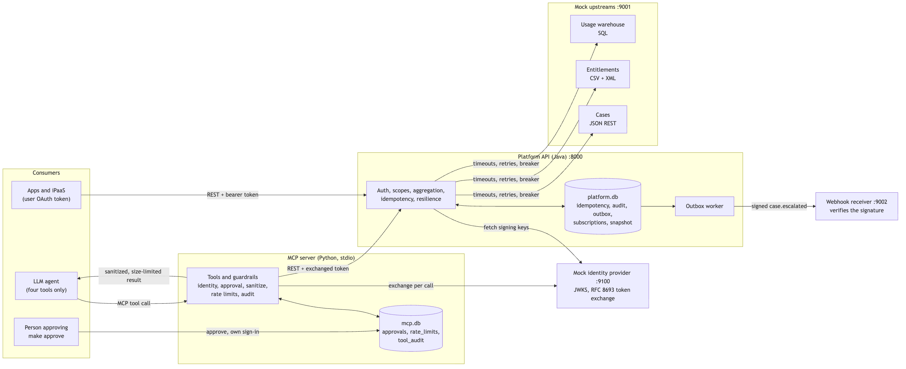
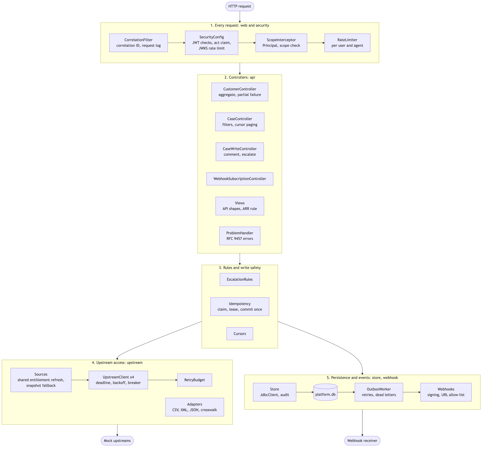
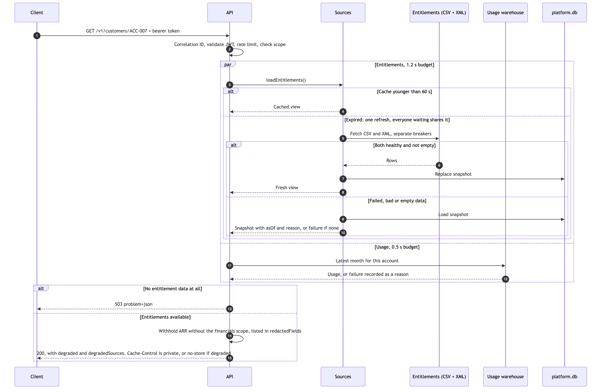
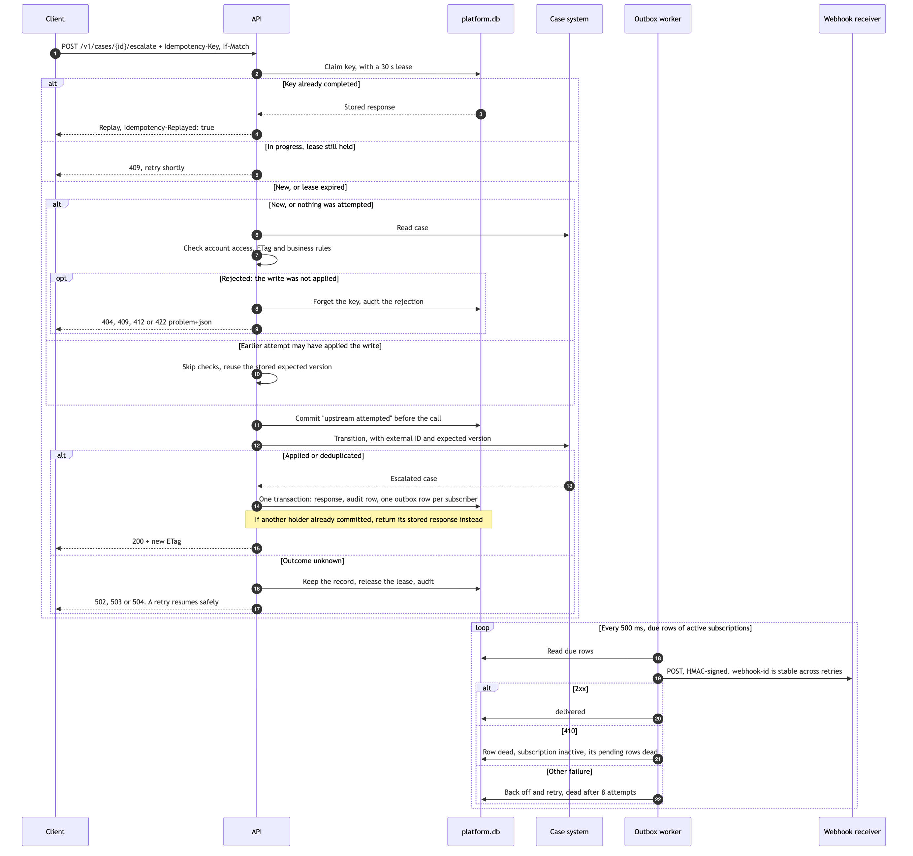
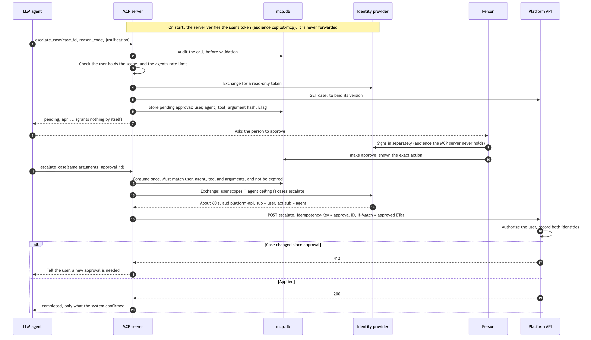
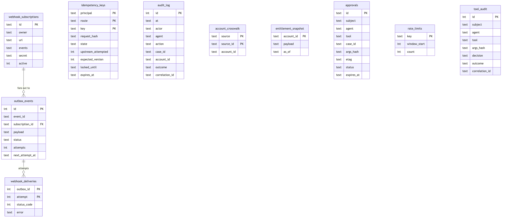

# Architecture and low-level design

How the platform fits together and how data moves through it. Each diagram's source is the matching `.mmd` file in `docs/diagrams/`. `DECISIONS.md` explains why it is built this way.

## 1. System and data flow
Apps and agents use the same API. Agents go through the MCP server, which adds guardrails and swaps the user's token for a short-lived one on every call. All upstreams and the identity provider are local mocks, and the only link between the parts is HTTP.

## 2. API components
A request passes through these layers from top to bottom. Packages are under `com.example.platform`.

## 3. Reading a customer, with partial failure
Entitlements and usage load at the same time, each with its own time budget. Usage is optional, so losing it degrades the response. Entitlements fall back to a snapshot, and the API returns 503 only if there is no data at all.

## 4. Escalating a case, then delivering the webhook
A retry after a lost response must succeed rather than fail its own checks, so "attempted" is committed before the upstream call. The response, audit row and outbox rows commit in one transaction.

## 5. MCP identity and human approval
The model only ever holds an approval ID, which grants nothing until a person approves that exact action elsewhere. The write scope isn't requested until then.

**Known gap:** the API can't yet verify an approval. A client holding a valid user-scoped token could call it directly. See "Known limits" in `DECISIONS.md`.

## 6. Data model
Only data this service owns is stored; case, entitlement and usage data stay in their source systems. `approvals`, `rate_limits` and `tool_audit` live in the MCP server's own `mcp.db`, and everything else is in `platform.db`. Key columns are shown; `platform-schema.sql` and `store.py` have the full definitions, and `DECISIONS.md` explains the indexes.

